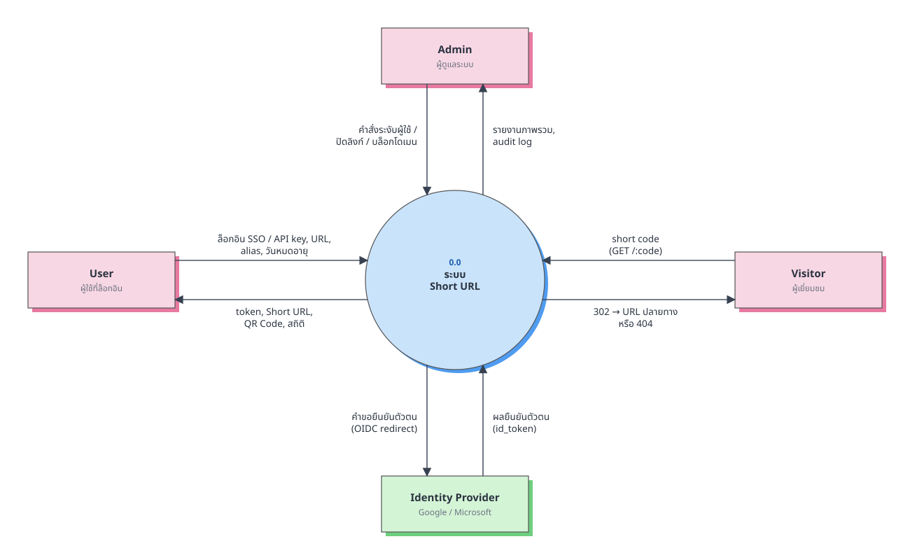
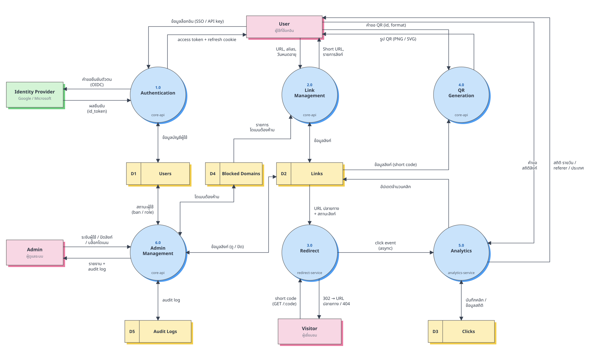
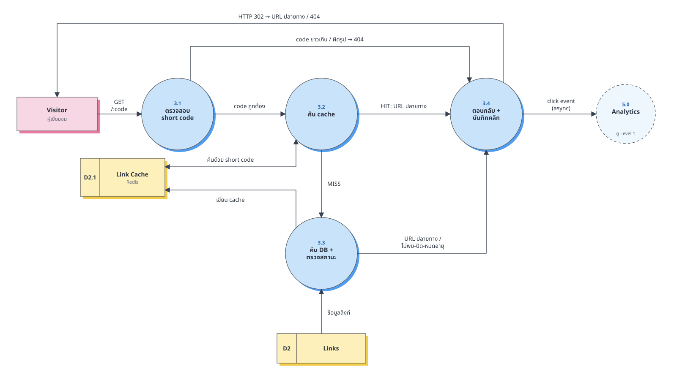

# Data Flow Diagram (DFD)

สัญลักษณ์ (แบบ Yourdon / DeMarco): **สี่เหลี่ยมสีชมพู** = External Entity (ผู้ใช้งาน), **สี่เหลี่ยมสีเขียว** = External Entity (ระบบภายนอก), **วงกลม** = Process (มีหมายเลข), **สี่เหลี่ยมสีเหลือง + รหัส D** = Data Store, **ลูกศร** = Data Flow (ตั้งชื่อเป็นข้อมูล ไม่ใช่การกระทำ)

หลักที่ใช้: ไม่มี flow ระหว่าง Data Store กับ Data Store หรือ Entity กับ Data Store ตรง ๆ, ทุก Process มีทั้งขาเข้าและขาออก, Level 1 สมดุลกับ Level 0, และไม่วาดรายละเอียดทางกายภาพ (Redis, cache) เป็น Data Store ที่ Level 0–1 (ดู [`architecture.md`](architecture.md)) · ดูแบบซูมได้ที่ [`diagrams.html`](diagrams.html)

## Level 0 — Context Diagram

## Level 1

| Process | หน้าที่ | Service |
|---|---|---|
| 1.0 Authentication | ล็อกอินด้วย SSO (Google / Microsoft) หรือ API key (CLI), ออก access token (15 นาที) + refresh token (7 วัน, หมุนทุกครั้ง), logout | core-api |
| 2.0 Link Management | สร้าง/แก้/ลบลิงก์, alias, วันหมดอายุ, ตรวจโดเมนต้องห้าม; ผู้เยี่ยมชมที่ไม่ล็อกอินย่อได้แต่ลิงก์สั้น 7 วัน | core-api |
| 3.0 Redirect | รับ short code → ตรวจวันเริ่ม/จำนวนคลิก/รหัสผ่าน → ตอบ 302 ไปยัง URL ปลายทาง (หรือ 404/403/410) แล้วส่ง click event | redirect-service |
| 4.0 QR Generation | ส่งเมทริกซ์ QR + เก็บ/ล้างสไตล์ QR ของลิงก์ (หน้าเว็บวาด PNG/SVG ตามสไตล์เอง), QR มาตรฐาน PNG/SVG สำหรับสคริปต์ | core-api |
| 5.0 Analytics | รับ click event เก็บลง Clicks เป็น batch, อัปเดตจำนวนคลิก, สรุปสถิติ | analytics-service |
| 6.0 Admin Management | ระงับผู้ใช้/เปลี่ยนบทบาท, ปิด-เปิดลิงก์, บล็อกโดเมน (ดูผลกระทบก่อน, ปิดลิงก์เดิมอัตโนมัติ), ดูสถิติลิงก์ทุกคน, ภาพรวม + audit log | core-api |

| Data Store | เก็บอะไร (ตาราง) |
|---|---|
| D1 Users | `users`, `sso_identities`, `api_keys` |
| D2 Links | `links` (รวมจำนวนคลิก `click_count`) |
| D3 Clicks | `clicks` (ดิบ, มี retention), `link_daily_stats` (สรุปรายวัน) |
| D4 Blocked Domains | `blocked_domains` |
| D5 Audit Logs | `audit_logs` |

## Level 2 — Process 3.0 Redirect (เส้นทางที่ถี่ที่สุด)

- 3.1 ตรวจสอบ short code → รูปแบบผิด/ยาวเกิน ส่งไป 3.4 เพื่อตอบ 404
- 3.2 ค้น Link Cache → HIT ส่ง URL ไป 3.4 · MISS ไป 3.3
- 3.3 ค้น D2 Links + ตรวจสถานะ/หมดอายุ → เขียนผลลง cache (รวม negative cache) แล้วส่งผลไป 3.4
- 3.4 ตอบกลับ Visitor (302 / 404) และส่ง click event ให้ Process 5.0 แบบ async — ไม่รอผล

> Level 2 แสดง Link Cache (D2.1) เพราะเป็นส่วนหนึ่งของตรรกะ redirect; Level 0–1 ถือว่า cache เป็นส่วนของ D2 Links
