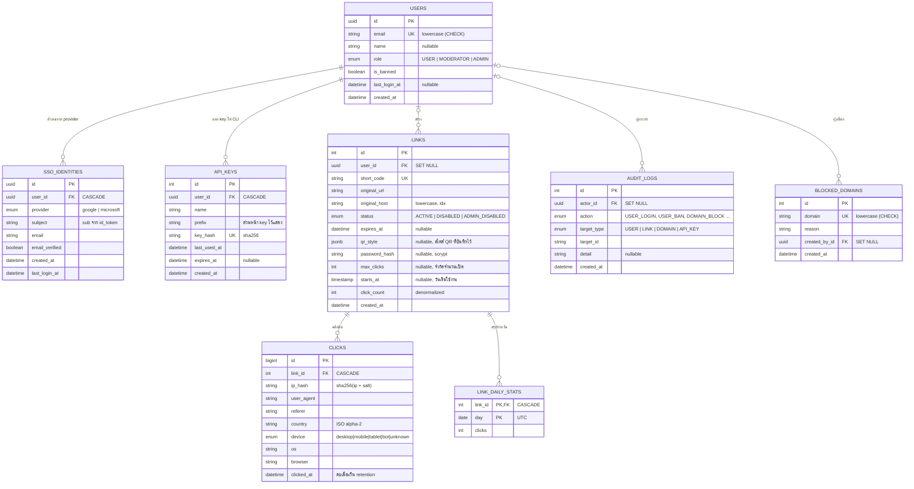

# ER Diagram

ภาพบนเว็บ: https://shorturl.kittametdev.com/docs/er/

ตรงกับ `services/core-api/prisma/schema.prisma` (วาดด้วย Mermaid — เปิดดูได้ใน GitHub, VS Code (Markdown Preview Mermaid), หรือ https://mermaid.live)



## หมายเหตุการออกแบบ

| เรื่อง | การตัดสินใจ |
|---|---|
| ไม่เก็บรหัสผ่านใน DB | ผู้ใช้ทั่วไปเข้าด้วย SSO; บัญชีเดโมของกรรมการล็อกอินด้วยรหัสที่ตั้งใน env (`DEMO_ADMIN_PASSWORD`) เทียบตรงๆ ตอนล็อกอิน → ตาราง `users` ไม่มีคอลัมน์รหัสผ่าน/hash ไม่มีตารางรีเซ็ตรหัส/ยืนยันอีเมล และไม่มี API ตั้ง/เปลี่ยนรหัส |
| `sso_identities` แยกจาก `users` | 1 คนผูกได้หลาย provider (unique `(provider, subject)` และ `(user_id, provider)`); ระบุตัวตนด้วย `sub` ไม่ใช่อีเมล (อีเมลเปลี่ยนได้); `email_verified` ใช้กันการยึดบัญชีข้าม provider (Microsoft ไม่รับรองอีเมล) |
| แอดมินคนแรก | seed สร้าง `users` (role ADMIN) ที่ยังไม่มี identity — เจ้าของอีเมลล็อกอินด้วย Google ครั้งแรกแล้วถูกผูกเข้าบัญชีนี้ |
| `api_keys` | CLI ไม่ใช้รหัสผ่าน (ผู้ใช้ทั่วไปไม่มี) → ใช้ personal access token; เก็บเฉพาะ sha256 (key เต็มแสดงครั้งเดียว), ลบแถว = เพิกถอน |
| `links.status` 3 สถานะ | `ADMIN_DISABLED` แยกจาก `DISABLED` (เจ้าของปิดเอง) — เดิมใช้ `status` + flag ซึ่งเกิดสถานะขัดแย้งได้ |
| `links.original_host` | เก็บ hostname แยก (มี index) → บล็อกโดเมน/ปิดลิงก์เดิมด้วย `WHERE original_host = d OR LIKE '%.d'` ไม่ต้อง parse URL ทุกแถว |
| `links.user_id` SET NULL | ลบผู้ใช้แล้วลิงก์/QR ที่แจกไปแล้วยังใช้ได้ |
| `links.qr_style` | JSONB (nullable) เก็บสไตล์ QR ที่ผู้ใช้ตั้ง: ลายจุด/ตา/สี/ไล่เฉด/โลโก้สำเร็จรูป/ข้อความใต้ QR/ขอบ — ผ่านการตรวจและกรองฟิลด์ก่อนเก็บ (ไม่เก็บรูปที่อัปโหลด); null = QR มาตรฐานดำบนขาว |
| `links.password_hash` | `scrypt$salt$hash` (salt สุ่มต่อลิงก์) ไม่เก็บรหัสจริง ไม่ส่งออกทาง API (DTO มีแค่ `hasPassword`); null = ไม่มีรหัส |
| `links.max_clicks` | จำกัดจำนวนครั้งที่เปิดได้ (1–1,000,000); ตัวนับจริงอยู่ใน Redis `lim:{id}` เพื่อให้นับแบบ atomic; null = ไม่จำกัด |
| `links.starts_at` | ก่อนเวลานี้ redirect-service ตอบหน้า "ยังไม่เปิดใช้งาน" (403); null = ใช้ได้ทันที |
| `links.user_id` NULL | ลิงก์ที่สร้างโดยไม่ล็อกอิน (`POST /api/guest/links`) ไม่มีเจ้าของ หมดอายุใน 7 วัน |
| `click_count` | เก็บซ้ำใน `links` เพื่ออ่านเร็ว; อัปเดตเป็น batch (`CLICK_FLUSH_SECONDS`=60) จากคิว Redis |
| `clicks` + `link_daily_stats` | คลิกดิบถูกลบเมื่อเกิน `CLICK_RETENTION_DAYS` (90) เพื่อไม่ให้ DB ฟรีเต็ม; ยอดรายวันสะสมใน `link_daily_stats` (เขียนใน transaction เดียวกับ clicks) จึงดูกราฟย้อนหลังได้ถาวร |
| `device` เป็น enum | ค่าปิดตายตัว; `os`/`browser`/`country` เปิดกว้างจึงเป็น text (country มี CHECK `^[A-Z]{2}$`) |
| `audit_logs` | `action`/`target_type` เป็น enum กันพิมพ์ผิด; `actor_id` SET NULL (ผู้กระทำถูกลบแล้ว log ยังอยู่); index `(action, created_at DESC)` รองรับตัวกรองในหน้าแอดมิน |
| CHECK constraint | email/domain/host ต้องเป็นตัวพิมพ์เล็ก, domain ต้องเป็นรูปแบบโดเมน — กันข้อมูลซ้ำต่างตัวพิมพ์ที่ unique index จับไม่ได้ (เขียนใน migration; Prisma schema เขียนไม่ได้) |
| `ip_hash` | ไม่เก็บ IP ดิบ (PDPA) hash พร้อม salt |
| refresh token | **ไม่เก็บใน DB** — JWT อายุ 7 วัน (httpOnly cookie) สถานะ rotation อยู่ใน Redis (`rt:{jti}`) |
| QR Code | ไม่มีตาราง — สร้างจาก short URL ตอนเรียก (`GET /api/links/:id/qr`) |

## ข้อมูลใน Redis (ไม่อยู่ใน ER)

| Key | ชนิด | ใช้ทำ | TTL |
|---|---|---|---|
| `link:{code}` | string (JSON) | cache redirect; ค่า `0` = negative cache | 1 ชม. / 60 วิ |
| `bl:{jti}` | string | blacklist access token ตอน logout | จนกว่า token หมดอายุ |
| `rt:{jti}` | string | refresh token ที่ยังใช้ได้ (ใช้ได้ครั้งเดียว: ลบทันทีตอนหมุน) | 7 วัน |
| `rtnbf:{userId}` | string (epoch ms) | "ไม่รับ token ที่ออกก่อนเวลานี้" เทียบกับ claim `iatMs` ใน JWT (ละเอียดกว่า `iat` ที่เป็นวินาที) — เพิกถอนทุก session (ban / ตรวจพบใช้ซ้ำ / ผูก SSO) | 7 วัน |
| `rl:{name}:{ip}` | counter | rate limit | ตามหน้าต่างเวลา |
| `rl:login-email:{email}` | counter | จำกัดการเดารหัสผ่านต่ออีเมล (10 ครั้ง/15 นาที; ล็อกอินสำเร็จแล้วลบ) | 15 นาที |
| `sso:{state}` | string (JSON) | state/nonce/PKCE verifier ของ SSO flow (GETDEL ตอน callback) | 10 นาที |
| `clicks:queue` | list | คิวคลิกรอเขียนลง DB | — |
| `clicks:flush:lock` | string | lock กันหลาย instance flush พร้อมกัน | 30 วิ |

## CHECK constraint ที่ต้องใส่ใน migration SQL เอง (Prisma schema เขียนไม่ได้)

```sql
ALTER TABLE "users"            ADD CONSTRAINT users_email_lowercase_chk         CHECK ("email" = lower("email"));
ALTER TABLE "links"            ADD CONSTRAINT links_original_host_lowercase_chk CHECK ("original_host" = lower("original_host"));
ALTER TABLE "blocked_domains"  ADD CONSTRAINT blocked_domains_domain_chk        CHECK ("domain" = lower("domain") AND "domain" ~ '^[a-z0-9]([a-z0-9.-]*[a-z0-9])?$');
ALTER TABLE "clicks"           ADD CONSTRAINT clicks_country_chk                CHECK ("country" IS NULL OR "country" ~ '^[A-Z]{2}$');
ALTER TABLE "link_daily_stats" ADD CONSTRAINT link_daily_stats_clicks_chk       CHECK ("clicks" >= 0);
ALTER TABLE "links"            ADD CONSTRAINT links_click_count_chk             CHECK ("click_count" >= 0);
```

Index ที่ต้องมี: `links(user_id, created_at DESC)`, `links(original_host)`, `clicks(link_id, clicked_at)`, `clicks(clicked_at)`, `audit_logs(action, created_at DESC)`, `audit_logs(created_at DESC)`, `api_keys(user_id)`; unique: `sso_identities(provider, subject)`, `sso_identities(user_id, provider)`, `api_keys(key_hash)`, `links(short_code)`, `users(email)`, `blocked_domains(domain)`
